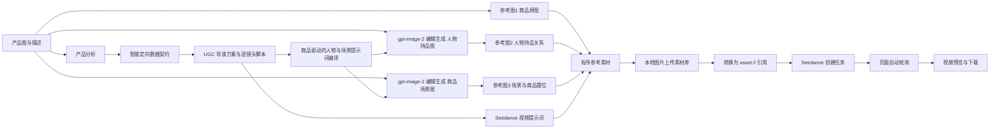

# Seedance UGC Studio 架构

## 命名参考目标

`public/references.js` 在前端和后端共用目标排序、名称校验和 `@{名称}` 编译规则。视频三张基础图之后最多追加 6 个命名目标；图片编辑按商品原图加命名目标顺序发送 multipart `image[]`。目标描述可限定图中的特定人物或物体。提交前校验缺图、重复名、非法标记和越界编号，编译后的“图片N”与真正发送的图片顺序一致。后台不向供应商发送自定义字段，视频仍使用标准 `content[].image_url` 和 `reference_image` 角色。首尾帧模式独立使用 `first_frame` / `last_frame`，不与多参考混用。

## 目标链路

## 分层

| 层 | 文件 | 责任 |
| --- | --- | --- |
| 浏览器界面 | `public/index.html`、`public/app.js`、`public/styles.css` | 四步工作流、模型配置、素材选择、任务状态与结果展示 |
| 本地网关 | `server.js` | 密钥保护、参数校验、供应商适配、超时与重试、图片资产处理、静态文件服务 |
| 本地资产 | `public/generated/` | 保存图片接口返回的 base64 结果，供页面预览和提交前素材库上传 |
| 外部供应商 | Yuncenai / Seedance | 图片生成、视频任务创建和异步任务查询 |

## 稳定性策略

- 浏览器不直接请求供应商，避免跨域和在网络请求中分散接口逻辑。
- 第二步六项选择被保存为导演数据契约；第三步输出前强制统一市场、平台、语言、形式、人物方式、时长和画幅。
- 第四步固定商品原图为图片 1、人物持品图为图片 2、商品场景图为图片 3；后端不信任前端图片顺序，按角色字段重新组装三参考请求，并把提示词统一编译为 Seedance 的“图片1/图片2/图片3”引用语义。
- 人物持品图与商品场景图分别调用图片编辑接口，但都强制携带图片1商品原图。图片2只补充人物、手势和持握关系，图片3只补充环境、机位和商品摆位，商品视觉细节始终以图片1为最高优先级。
- 商品场景图的提示词同时注入第二步市场/平台/形式与第三步逐镜头脚本，场景必须服务实际使用动作，不允许无关风景。
- 产品、分析或导演方案变化时清除旧图片和旧视频任务，防止跨项目资产污染。
- 本地图片由后端自动上传 `/v1/materials/uploads`、创建 `/v1/materials` 素材记录，并轮询等待素材 ready（最长 120 秒）后以 `asset://<asset_id>` 提交；素材编号会在等待前缓存，重试时继续查询同一素材，不再依赖未在供应商文档中声明支持的 data URL。
- 默认只提交商品原图、最新人物持品图和最新商品场景图三张素材，缺少任意一张都拒绝发起严格参考任务。
- `/api/seedance/validate` 在创建任务前检查模型名、Endpoint、画幅、时长、三图数量与顺序、图片1商品最高优先级、图片2持握关系、图片3场景摆位、单件商品规则、参考图传输方式和请求体大小。
- Base URL、Endpoint、生成模式、画幅、时长和素材数量在本地先校验。
- 外部请求有 20-120 秒分级超时；Cloudflare 502 自动重试一次。
- 创建和查询响应统一为 `taskId/status/videoUrl/failedReason/progress`。
- 视频提交后每 6 秒自动轮询，查询短暂失败最多自动恢复 3 次；长任务会自动降低轮询频率。
- 进度面板优先显示供应商进度；供应商未返回数字时显示不会到达 100% 的预估进度，并明确标注来源。
- 完成状态与成片 URL 分阶段同步，供应商先完成后返回地址时会继续查询。
- 任务 ID、开始时间、状态和成片地址会在本地恢复，刷新页面后可继续同步或查看结果。
- 图片结果和视频结果均回到前端展示；成片通过本地网关流式下载，不依赖供应商后台。

## 故障边界

| 现象 | 归属 | 当前处理 |
| --- | --- | --- |
| 400 参数错误 | 本地输入或接口配置 | 提交前拦截并显示具体字段 |
| 401/403 | 密钥无效或账号无权限 | 接口检查直接提示 |
| 413 | 请求体过大 | 本地图片改走素材库 asset 引用、900KB 请求上限 |
| 502 Cloudflare Host Error | 供应商主机不可用 | 自动重试一次并显示精简原因；本地无法替供应商恢复主机 |
| 查询暂时失败 | 网络或供应商波动 | 页面自动重试，仍可手动刷新 |

## 验证

`npm test` 使用本地模拟供应商验证完整异步任务契约。真实供应商是否能最终出片，还取决于密钥权限、账户额度和供应商主机状态；这些外部条件不会影响演示模式与本地链路测试。
